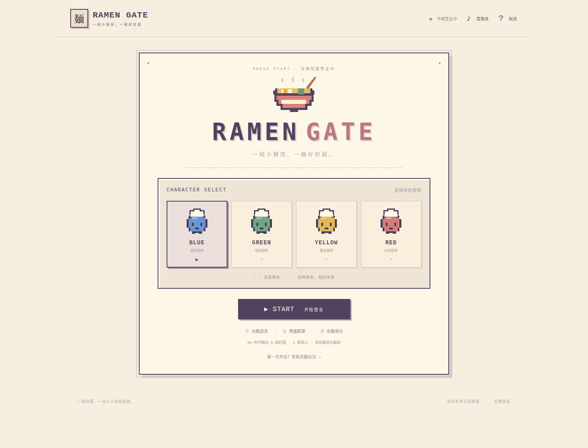

# RAMEN GATE · 拉面小厨房

可玩的中文浏览器小游戏：四色圆形像素厨师、8-bit 俯视厨房、粉色 / 奶油色棋盘地面、工作站探索和五星结算。支持键盘与触屏，无需账号、密钥或付费服务。



## 先看实际怎么玩

**[真实试玩 MP4](artifacts/ramen-gate-actual-playthrough.mp4)** · 77.86 秒 · 1600×1000 · 中文字幕 · 游戏原声音效。

录像来自真正运行的浏览器游戏，以正常方向键和 Z 键完成选角色、冰箱取材、煮汤搅拌、切配、装碗和结算。没有直接修改游戏状态，也没有模拟时钟。六碗全部完成，结果为 **1125 分、五星**。GitHub 若没有直接显示播放器，可在文件页使用 **Download raw file** 下载观看。

## 试玩与源码

- **[单文件试玩版](artifacts/ramen-gate.html)**：下载 HTML 到自己的电脑，用浏览器打开。GitHub 文件页只查看代码，不会直接运行游戏。
- **[完整源码 ZIP](artifacts/ramen-gate-source.zip)**：包含游戏、构建和测试代码及中文说明；录像单独提供。
- **[厨房截图](artifacts/02-game-desktop.png)**、[煮汤菜单](artifacts/08-cook-station.png)、[手机界面](artifacts/05-game-mobile.png)、[真实试玩结算](artifacts/recorded-playthrough-result.png)。

也可下载源码后运行，无需 `npm install`：

```sh
npm run dev
```

再在同一台电脑打开 `http://localhost:4173`。生产构建使用 `npm run build`，预览构建结果使用 `npm run preview`。更换端口用 `PORT=4174 npm run dev`。

云端运行时，localhost 属于云端机器，不能当作公网链接。本项目没有公开部署网站，也没有第三方隧道。

## 操作与完整循环

1. 选择 BLUE、GREEN、YELLOW 或 RED。颜色不同，本领相同。
2. 用方向键或 WASD 移动到右上角 **FRIDGE**，面朝工作台按 **Z / A**，按订单选择汤底，获取汤底与拉面。
3. 到 **COOK** 选择搅拌方式，开始煮汤和面；火候进入绿色区时，再按 Z / A 完成。轻柔搅拌为普通速度，大火翻滚快 25%。煮糊后可重煮。
4. 到 **CHOP** 选对应配料，再到 **BOWL** 按 Z / A 出餐。
5. 90 秒内完成 6 碗获胜；错单、糊面出餐或客人等待 24 秒各扣一颗心。失去 3 颗心或时间耗尽则结束。
6. 结算查看分数、星级、完美火候和连击，可直接重开或返回选角。

| 操作 | 键盘 | 鼠标 / 触屏 |
| --- | --- | --- |
| 移动 | 方向键 / WASD | 按住屏幕方向键 |
| 互动 / 确认 | Z，兼容空格 | A |
| 菜单选择 | 方向键 | 点击选项，或方向键 + A |
| 取消 | X | B |
| 暂停 / 继续 | Enter（Start）、P（Select）、Esc | 暂停 / 继续营业 |
| 清空当前碗 | R | 清空这碗 |
| 切换角色 | 选角卡聚焦后的方向键 | 点击颜色卡 |

小箭头显示朝向；工作台与桌子有碰撞。打开玩法、切换后台或窗口失焦会暂停。音效默认关闭。最佳分数仅保存于当前浏览器，禁用存储时仍可玩。

## 参考与原创范围

参考官方演示：<https://x.com/OpenAIDevs/status/2112242741555941550>。

本版依据实际查看视频后核实的关键帧信息制作：RAMEN GATE 标题、四色圆形像素脸、方框菜单、俯视棋盘厨房、COOK / CHOP / BOWL 工作台与冰箱、底部对话框、面朝工作台按 A 互动、粉色冒汽锅及搅拌菜单。像素素材均自行绘制，没有复用视频素材，也不声称一比一复刻。

参考剪辑中可见 FRIDGE / PICK INGREDIENTS（约 42–43 秒）、EXPLORE THE KITCHEN / FACE A STATION: A（约 57 秒）、BROTH / STIR WITH LOVE（约 58–59 秒）和 MAKE A 5-STAR RAMEN（约 66–67 秒）。被裁切或无法辨认的文字未当作完整原文复刻。

**原创补全**：订单配方、90 秒六碗目标、三颗心、24 秒耐心、火候窗口、搅拌速度、计分与星级规则。普通出餐 100 分，完美加 50 分；连击每次增加 15 分、最多 75 分。通关基础 3 星，每约 3 碗完美增加 1 星，最高 5 星；未通关按出餐数评星。

## 验证

```sh
npm run lint
npm test
npm run build
npm run dev
# 保持服务运行，另开终端：
npm run test:e2e
```

已通过：

- 零依赖 lint：JavaScript 语法、源码卫生、CSS 括号与入口外部请求检查；不是完整 ESLint / CSS 语义检查。
- **11 项逻辑测试**：胜负、计分、四色角色、公平性、暂停、超时、重煮、重开及搅拌速度。
- **73 项浏览器断言**：真实 Chromium 键盘通关、触屏方向键通关、五星结算、失败、取消菜单、暂停与重开；320–1024 像素布局检查；没有浏览器脚本错误。
- 生产单文件 HTML 内容在断网浏览器中实际做面，无外部资源请求。
- MP4 完整解码检查通过，已核对六个关键阶段画面，并确认存在非静音游戏音轨。

报告：[浏览器测试](artifacts/browser-test-results.json)、[录像验证](artifacts/playthrough-video-validation.json)、[录屏关键帧](artifacts/playthrough-keyframes-review.jpg)。

未验证：真实 iPhone / Android、Safari / Firefox、物理扬声器听感、公网网站访问。本执行环境的浏览器策略阻止 `file://` 导航，因而未在此验证双击 HTML 入口；已通过 HTTP 和离线 HTML 内容验证。

## 结构

- `src/engine.mjs`：规则与状态机。
- `src/app.js`：移动、碰撞、工作站交互、菜单、计时、结算和存档。
- `src/art.js`、`src/style.css`：自绘像素 SVG 与响应式界面。
- `scripts/`：本地服务、检查、构建及真实试玩录制 / 视频打包脚本。
- `tests/`：逻辑测试与 Playwright 浏览器测试。
- `artifacts/`：单文件版、源码包、截图、报告和真实录屏。

浏览器测试和录制使用环境已有的 Python Playwright、Chromium 与 FFmpeg；游戏运行本身不依赖这些工具。
